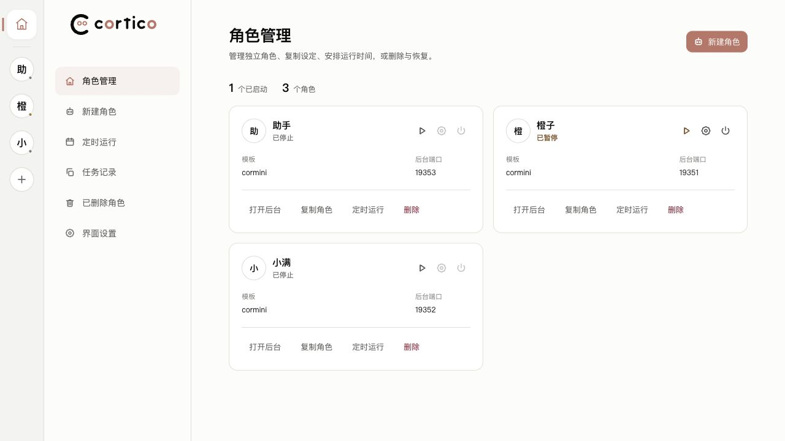
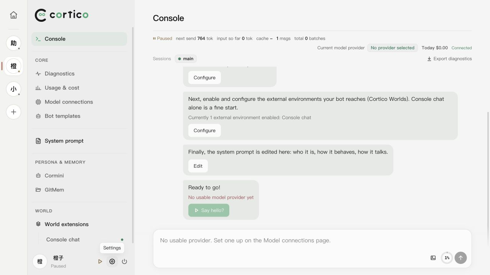
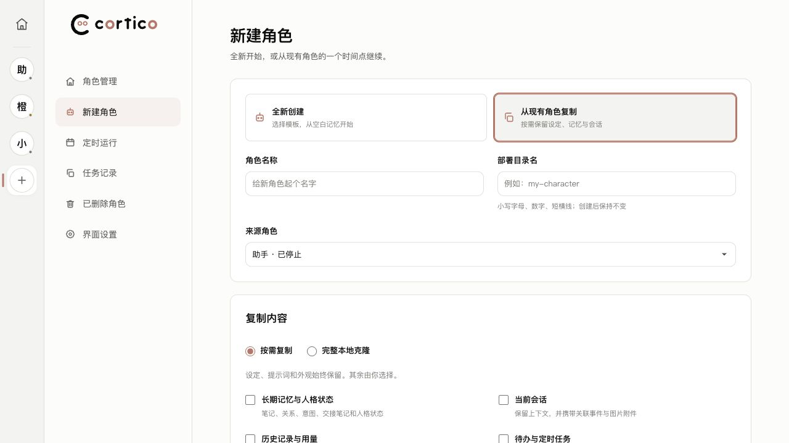
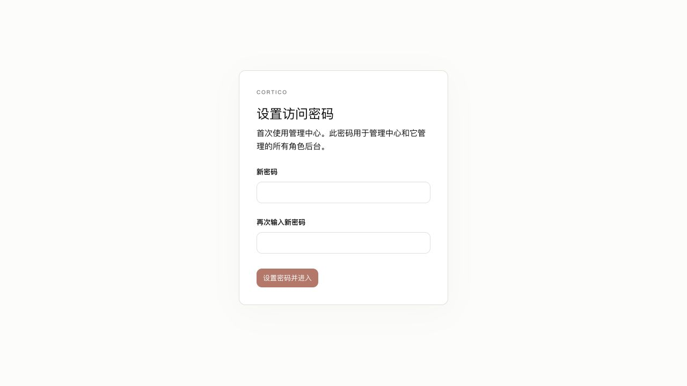
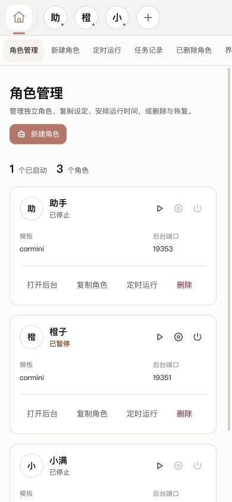

# Cortico Multi-Role Manager

独立的 Cortico 多角色管理面板。统一登录，在多个角色后台间切换，保留 Cortico 原版 WebUI；无需修改官方源码或页面。



## 功能

- 启动、暂停、继续、关机，以及角色后台切换。
- 新建角色、按需复制、完整本地克隆与启动前检查。
- 定时运行、任务记录、失败重试、回收站。
- 首次设置密码、修改密码、统一退出；多语言、主题和手机布局。

## 安装与启动

需要 **Node.js 22+**，以及一份已按照 [Cortico 官方说明](https://github.com/Pal-AI-Lab/Cortico#readme) 安装完成的 Cortico。

从 [Releases](https://github.com/lkon2112/cortico-multi-role-manager/releases) 下载并解压源码包，在项目目录执行：

```sh
npm ci
npm run build
npm start -- --cortico /path/to/Cortico --data ./data
```

把 `/path/to/Cortico` 换成 Cortico 安装目录（包含 `bin/cortico.mjs`），路径有空格时加引号。保持这个终端运行，打开 **http://127.0.0.1:19000**，首次访问设置自己的管理密码，然后新建角色；没有预设密码。

新角色启动后先保持暂停。在角色后台配置模型与 World，点击继续即可运行。角色代理使用管理端口之后的可用端口，需一并允许浏览器访问。

直接打开任一托管角色的后台地址，也会自动进入管理中心并选中该角色，保留原链接的页面位置；未登录时统一登录，已停止的角色显示启动入口。

例如，管理中心使用 `19000`，角色入口使用 `19001`、`19002`。打开 `http://127.0.0.1:19002/#/settings`，会进入带角色切换栏的第二个角色设置页。入口由管理器自动提供，无需修改官方代码或已有角色的端口。请收藏管理器提供的角色地址；独立启动、尚未由管理器托管的原版后台保持原样。

局域网使用：

```sh
npm start -- --cortico /path/to/Cortico --data ./data --host 0.0.0.0 --port 19000
```

用这台电脑的局域网 IP 访问，并允许管理端口和角色入口端口通过防火墙。管理中心和角色链接应使用同一个 IP 或主机名，以共用登录状态。当前使用 HTTP，适用于本机和可信局域网。

## 数据与更新

`--data` 保存角色、扩展、管理密码和任务记录。管理器使用独立部署目录，不自动接管 Cortico 已有角色。请备份此目录，并在重启或更新时沿用同一路径。

- **更新 Cortico**：按官方方式更新原安装目录，再按提示重启角色。
- **更新管理器**：按 Ctrl+C 正常退出，替换项目代码，执行 `npm ci` 和 `npm run build`，使用原参数启动。
- 正常退出管理器会保存并关闭它启动的角色；下次启动后手动启动角色，或由已设置的定时任务启动。

复制运行数据时，来源会短暂正常关机，完成后恢复原状态。副本保持停止。完整克隆包括部署目录内的插件数据和连接配置，启动前可检查并关闭冲突的 World；部署目录外的数据和远端账号仍共享原位置。按需复制第三方 Bot 的分类规则见 [接入与复制说明](docs/architecture.md)。

## 兼容与开发

已验证官方 Cortico v0.2.13，以及 v0.2.12 → v0.2.13 的数据沿用。对接官方启动器与 WebUI HTTP API，HTML 原样转发。后续若官方更改这些接口，需要更新管理器的对应适配。

```sh
npm run typecheck
npm run build
CORTICO_MANAGER_TEST_SOURCE=/path/to/Cortico npm test
```

跨版本验证可同时设置 `CORTICO_MANAGER_TEST_OLD_SOURCE`。测试创建临时数据，不需要模型账号。当前实测平台为 macOS；Windows 进程管理分支尚未实机验证。

## 界面预览

演示使用空白角色。







## 许可

MIT，作者 **lkon**。这是独立社区项目。复用的 Cortico 图标、样式和主题代码保留原作者许可，见 [LICENSE.cortico](LICENSE.cortico)。
